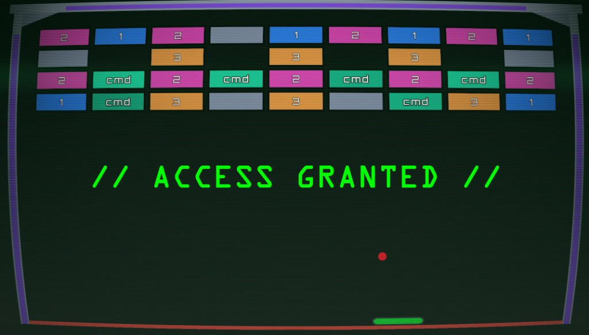

# Gameplay Engineering · Technical Design · Tooling

Hey there! I'm Marwan. I'm currently a solo developer, **Gold Leaf Interactive** is my studio. I design and build games with readable mechanics, replayable loops, and intentional design. I've worked across many different aspects of game development, mostly focused on gameplay programming, level scripting, and in-editor production pipelines.

Unreal Engine 5 (C++ & Blueprints) and Unity 6 (C#) are what I use. Several smaller games are up on [itch.io](https://goldleafinteractive.itch.io), and a larger one is on the way to Steam.

I've played games for a long time. That experience mostly factors in when I'm playtesting on my own, when something feels off but not necessarily wrong. This helps me polish and refine features and systems in a specific way, having experienced and understood games as a player over many years.

---

## What I'm Building

Since graduating, most of my time has gone into a wave survival FPS in Unreal Engine 5.5 (C++). It's in private beta. It will come to Steam under **Gold Leaf Interactive** when there's something public to show.

- **Play in browser:** [Access Granted](https://goldleafinteractive.itch.io/access-granted) · [Dread & Breakfast](https://goldleafinteractive.itch.io/dread-and-breakfast) · [Trenchglow](https://goldleafinteractive.itch.io/trenchglow) · [UNSUB](https://goldleafinteractive.itch.io/unsub) · [BREATHE Arcade](https://goldleafinteractive.itch.io/breathe-arcade)

---

## Featured Work

  

A Unity 6 browser game. Brick-breaker plus reactive typing challenges. Click the image to play it on itch.io.

  <a href="projects">View all projects →</a>

  

Click the logo to open Gold Leaf Interactive on itch.io.

---

## How I Work

- Unreal and Unity.
- I design gameplay systems & more, build out their features and mechanics in code, then tune parameters in-engine---while playtesting---until the mechanic feels right.
- Playtests help me decide what stays and what could be built upon. Playtesters provide notes and bug reports for me to intake, and I try to accomodate players as best as I can, while also maintaining my vision and direction for the game(s).

---

## Connect

- **Itch.io:** [goldleafinteractive.itch.io](https://goldleafinteractive.itch.io)
- **LinkedIn:** [Marwan Charafeddine](https://www.linkedin.com/in/marwan-charafeddine-213065155)
- **GitHub:** [mcharafeddinedev](https://github.com/mcharafeddinedev/GameDev-Portfolio)

---

<a href="mylib">Games that shaped me →</a>

