

# Game Projects

---

## In Development

**Unannounced wave survival FPS.** Unreal Engine 5.5 (C++), in private beta. No public build yet. It will be announced when there's something to play.

---

## Featured

### Access Granted
Unity 6 · C# · URP · Released · Browser & Windows

A brick-breaker that stops you to type commands, inside a CRT terminal. Dropping the ball and mistyping are different failures, and the scanlines stay readable while you play.

  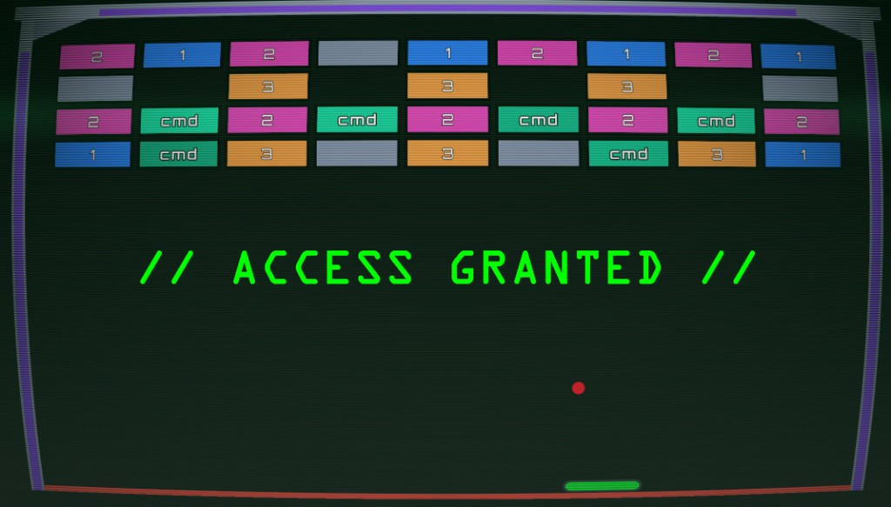

  <iframe id="itch-embed-access-granted-projects" title="Itch.io: Access Granted" frameborder="0" loading="lazy" src="https://itch.io/embed/4475328?linkback=true&amp;border_width=2&amp;bg_color=060d06&amp;fg_color=b9c6e4&amp;link_color=00edd6&amp;border_color=084808" width="552" height="167" class="itch-embed"></iframe>

[Play In Browser](https://goldleafinteractive.itch.io/access-granted) · [Patch Notes v2](https://goldleafinteractive.itch.io/access-granted/devlog/1516113/patch-notes-v2)

---

### UNSUB {#unsub}
Unity 6 · C# · URP · Game jam / Released · Browser

Noir detective game built for Brackeys Game Jam 2026.2. 
Harlan Voss was found dead behind the Blue Lantern Nightclub; you are a new detective at the precinct. 
One full case, about 15–20 minutes. You inspect the evidence, catch contradictions, and only get one accusation.

  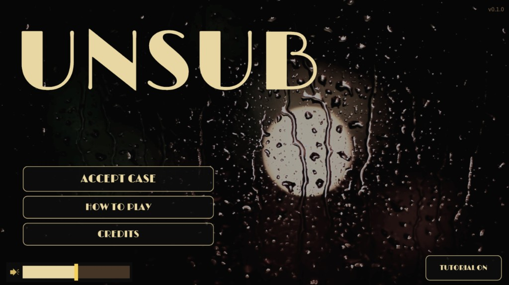

  <iframe id="itch-embed-unsub-projects" title="Itch.io: UNSUB" frameborder="0" loading="lazy" src="https://itch.io/embed/4951501?linkback=true&amp;border_width=2&amp;bg_color=120c08&amp;fg_color=e8d9c0&amp;link_color=d4c4a0&amp;border_color=3a2a1c" width="552" height="167" class="itch-embed"></iframe>

[Play In Browser](https://goldleafinteractive.itch.io/unsub) · *Brackeys Game Jam 2026.2*

---

### Dread & Breakfast
Unity 6 · C# · Beta / Post-jam · Browser & Windows

A top-down haunting game. Nights get harder, the house reshuffles, and a fright shop carries your progress between runs.

  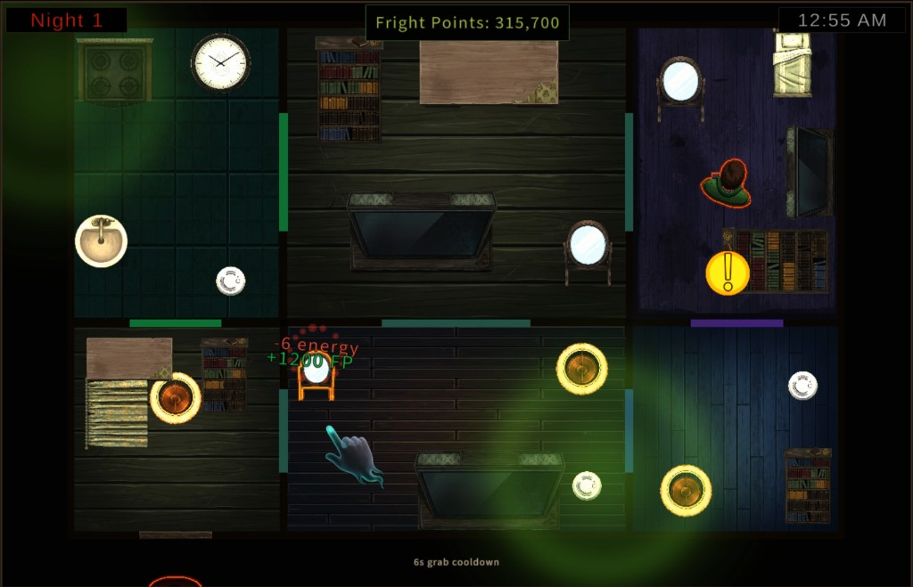

  <iframe id="itch-embed-dread-breakfast" title="Itch.io: Dread & Breakfast" frameborder="0" loading="lazy" src="https://itch.io/embed/4471600?linkback=true&amp;bg_color=000000&amp;fg_color=e6d699&amp;link_color=fa5c5c&amp;border_color=282828" width="552" height="167" class="itch-embed"></iframe>

[Play In Browser](https://goldleafinteractive.itch.io/dread-and-breakfast) · Started at *Mini Jam 208: Inverted* (2026) · [Patches](https://goldleafinteractive.itch.io/dread-and-breakfast/devlog/1489095/update-1-fixes-energy-bubbles-deep-freeze) · [v0.9 beta](https://goldleafinteractive.itch.io/dread-and-breakfast/devlog/1501963/patch-notes-v090-beta)

---

### Trenchglow {#trenchglow}
Unity (2D URP) · C# · Released · Browser

Deep-sea exploration where sonar is how you see. Playable in the browser, past the tutorial, with more trenches and puzzles.

  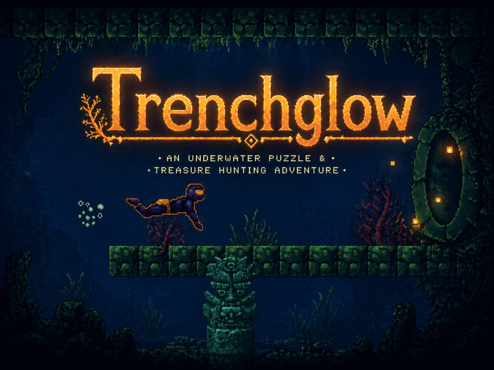

  <iframe id="itch-embed-trenchglow" title="Itch.io: Trenchglow" frameborder="0" loading="lazy" src="https://itch.io/embed/4513861?linkback=true&amp;bg_color=0a1628&amp;fg_color=cfe8ff&amp;link_color=f5a524&amp;border_color=1a3d5c" width="552" height="167" class="itch-embed"></iframe>

[Play In Browser](https://goldleafinteractive.itch.io/trenchglow)

---

### BREATHE Arcade {#breathe-arcade}
Unity 6 · C# · 2D URP · Capstone Project · Browser & Windows

Five small games you play with your breath. A custom fan, a USB mic, or the keyboard all drive the same games, so it can be shown without the hardware.

  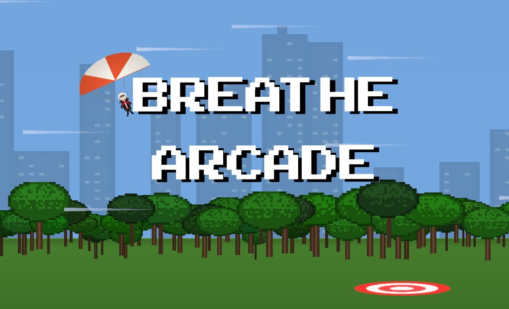

  <iframe id="itch-embed-breathe-arcade" title="Itch.io: BREATHE Arcade" frameborder="0" loading="lazy" src="https://itch.io/embed/4475446?linkback=true&amp;bg_color=d6f5ff&amp;fg_color=0b2d3f&amp;link_color=ff4f6e&amp;border_color=93cdea" width="552" height="167" class="itch-embed"></iframe>

[Play In Browser](https://goldleafinteractive.itch.io/breathe-arcade)

---

### OVERCLOCKED: Data Dash MAX
Unreal Engine 5 · C++ & Blueprints · Capstone Project · Released (PC & Arcade Cabinet)

An endless runner for PC and an arcade cabinet. Change lanes, grab pickups, and watch the run speed up across six visual themes. The feel was tuned on both the desktop and the cabinet.

  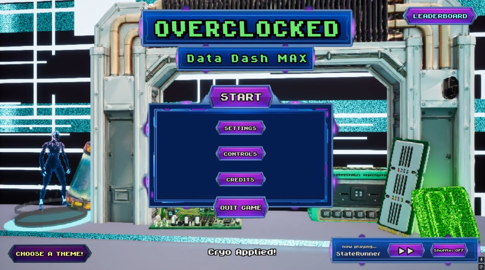

  <iframe id="itch-embed-overclocked-projects" title="Itch.io: Overclocked DDM" frameborder="0" loading="lazy" src="https://itch.io/embed/4278897?linkback=true&amp;border_width=5&amp;bg_color=000000&amp;fg_color=fffcbc&amp;link_color=46ffd4&amp;border_color=979797" width="552" height="167" class="itch-embed"></iframe>

[Windows build on Itch.io](https://goldleafinteractive.itch.io/overclocked-ddm) · [Patch v1.1.0](https://goldleafinteractive.itch.io/overclocked-ddm/devlog/1379247/v110-patch-notes-overclocked-ddm) · [Trailer](https://www.youtube.com/watch?v=dI9Ctq9LkLs)

---

### Quantum Tether
Unity · C# · Released · Texas Game Jam 2025 (EGaDs, UT Austin)

Endless roguelike sidescroller made in a weekend: swing on stars and asteroids with the mouse, unlock a second rope, contract the rope to pull yourself along, and dash toward the cursor to recover from bad swings. Red corrupted anchors are traps, one touch ends the run, and time crystals feed upgrades and score progression. Inspired by the old flash game *Spider-Man: City Raid*.

  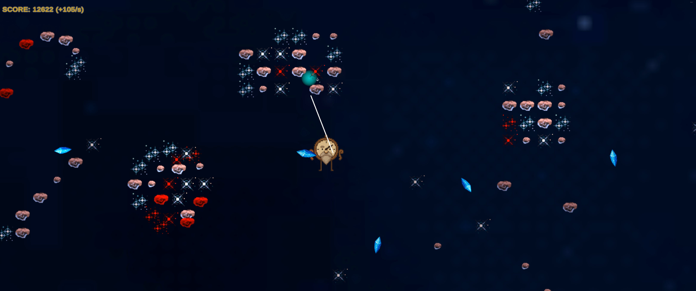

[View on Itch.io](https://goldleafinteractive.itch.io/quantum-tether) · [Trailer](https://www.youtube.com/watch?v=RNs4yKPhfGM)

---

### Mysteries of Tupni
Unreal Engine 5 · Blueprints · Prototype

A third-person fantasy action adventure, and one of my first games. I did the early design, then inventory, interactables, and quests, with another student and purchased art.

  

[View on Itch.io](https://goldleafinteractive.itch.io/mysteries-of-tupni) · [Demo](https://www.youtube.com/watch?v=BQl2MkPxUl4)

---

### Ginger Shroom Journey
Unity · C# · Steam · Prototype

A small 2D adventure, free on Steam. I built the game around purchased art: the systems, UI, sound, and ten hand-painted levels.

  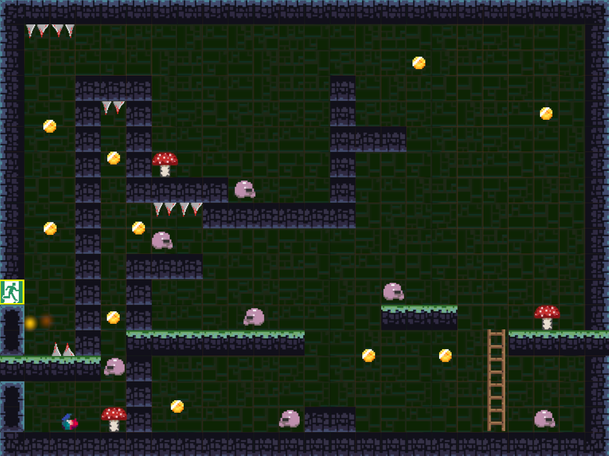

[Steam (free)](https://store.steampowered.com/app/3023100/Ginger_Shroom_Journey/) · [Trailer](https://www.youtube.com/watch?v=-LGDr3DaUB8)

---

## Earlier Prototypes & Jams

### Void Knights
Unreal Engine 5 · Blueprints · Prototype

A *Persona*-inspired prototype with two realms. I built the exploration: swapping between them, telekinesis, and the props and patrols in the spaces. Made with a lead designer and a lead programmer.

  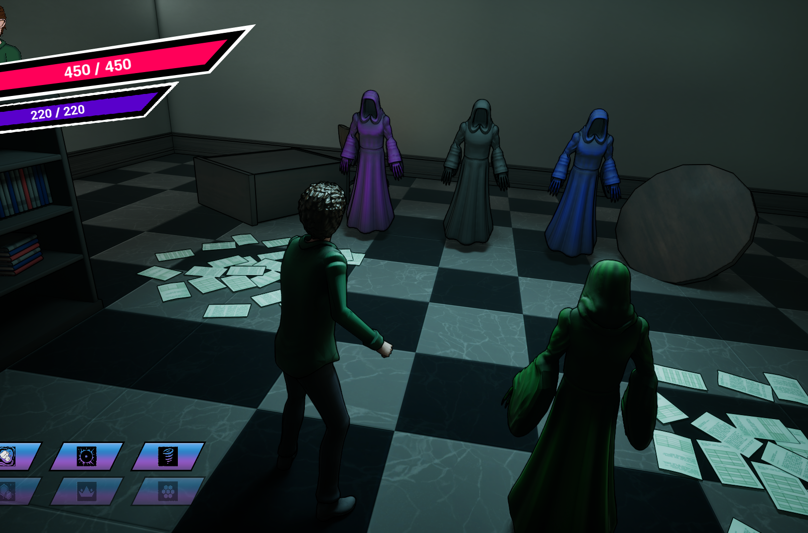

[View on Itch.io](https://goldleafinteractive.itch.io/void-knights)

---

### Medieval Shop Game
C++ · Windows · Prototype

An ASCII shop: stock the shelves, haggle, and talk your way through branching conversations. A class project.

  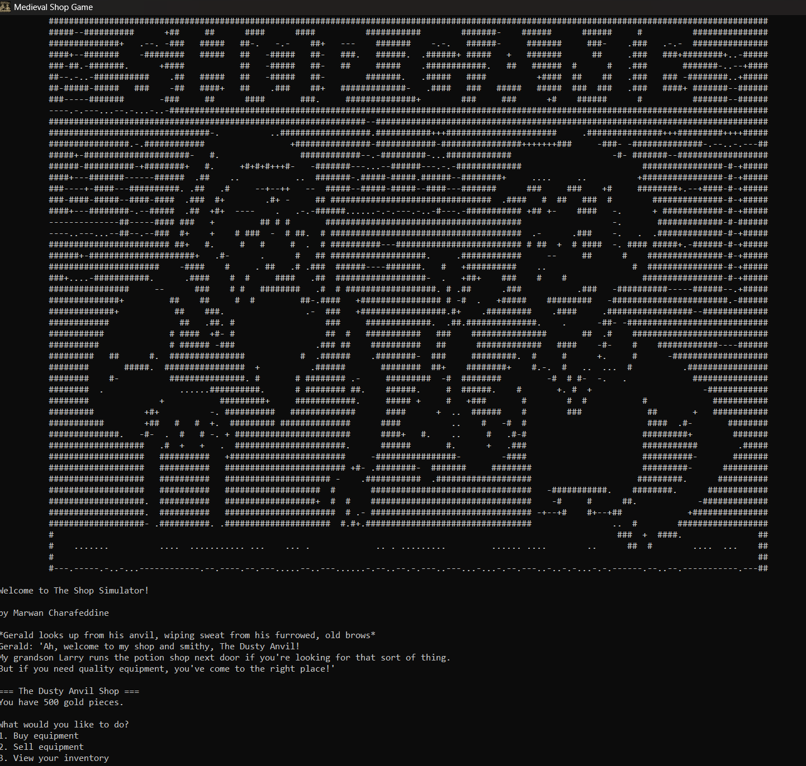

[View on Itch.io](https://goldleafinteractive.itch.io/medieval-shop-game)

---

### Million Miles Deep
Unreal Engine 5 · Blueprints · Prototype

A top-down oceanic shooter. I designed enemy patterns, set up projectiles, and playtested.

  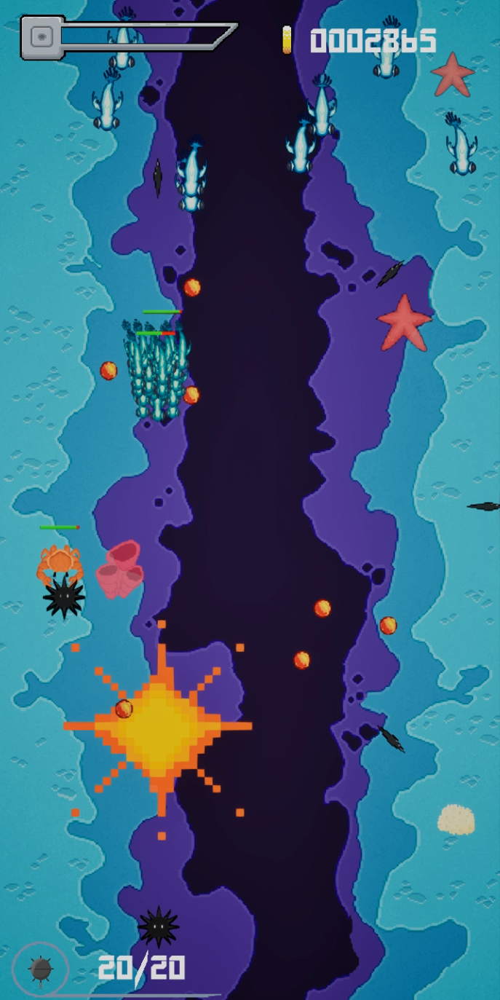
  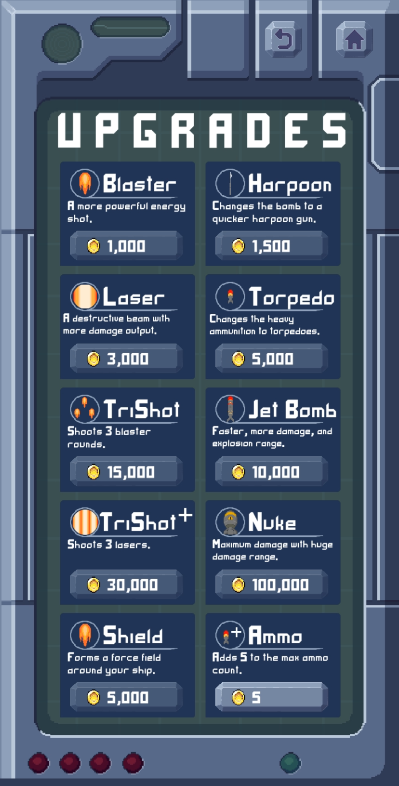

[View on Itch.io](https://goldleafinteractive.itch.io/million-miles-deep)

---

### Ragdoll Plainly Perilous
Unreal Engine 5 · Blueprints · Jam

You play as a ragdoll. Made for Chillenium 2025, after the old flash game *Ragdoll Avalanche 2*.

  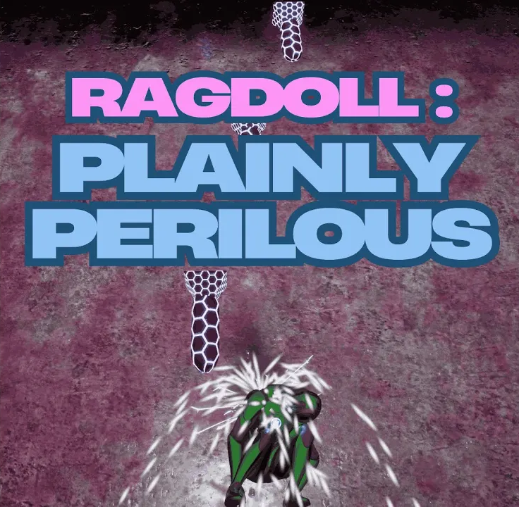

[View on Itch.io](https://goldleafinteractive.itch.io/ragdoll-plainly-perilous) · [Demo](https://www.youtube.com/watch?v=GfrDt166KZI)

---

### Crimson Eclipse
Unreal Engine 5 · Blueprints · Prototype

Side-scrolling horror. I did the engine work, the levels, and the build, with artist teammates from class.

  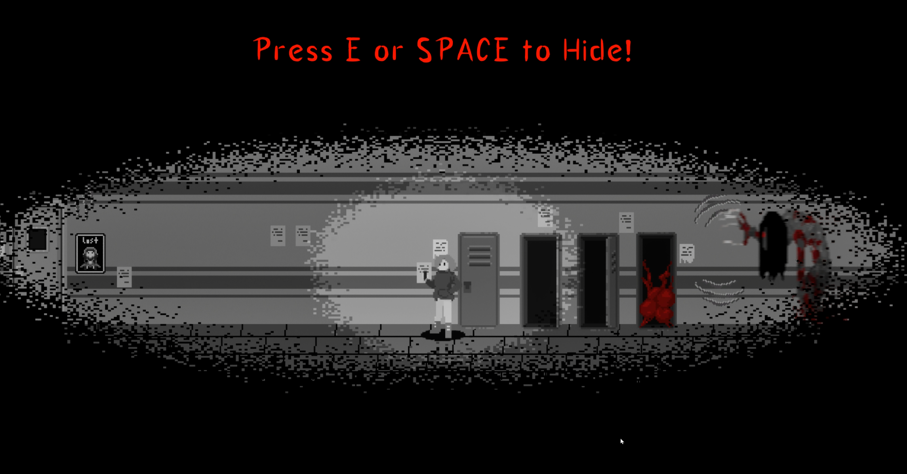

[View on Itch.io](https://goldleafinteractive.itch.io/crimson-eclipse) · [Demo](https://www.youtube.com/watch?v=R7KG3vuqHx4)

---

## More

- [I AM INEVITABLE](https://goldleafinteractive.itch.io/i-am-inevitable) (UE5 · Chillennium '26): you get stronger as you fail, and you can run on walls and dash
- [Doors n' Dice](https://goldleafinteractive.itch.io/doors-n-dice)
- [Escape Control](https://goldleafinteractive.itch.io/)

---

